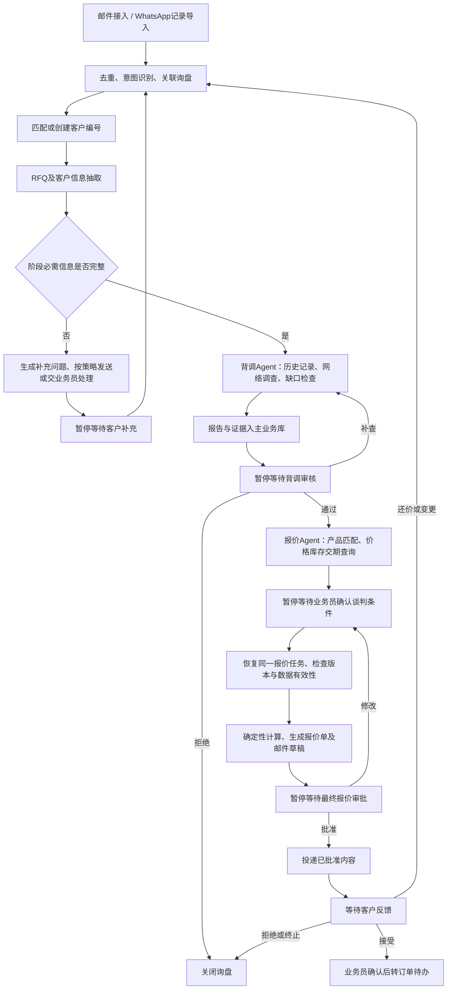

# 外贸询盘双 Agent 工作流修改策略

日期：2026-09-22  
状态：待实施设计；本文不代表相关功能已经完成。  
范围：询盘接收、客户档案、RFQ、背调、人工确认、报价、邮件发送和反馈；订单履约另行设计。

## 1. 已确定的业务方向

项目调整为面向内部业务员的外贸询盘处理系统，使用一个业务工作流组织背调 Agent、报价 Agent、业务工具与人工操作。

- 独立客户咨询 Agent 与 Workspace Peer 协作退出默认业务链。客户通过邮件或 WhatsApp 提供资料，不要求登录客户 Agent 门户。
- 首次询盘即可建立客户档案和稳定客户编号；没有购买记录不影响开展背调。
- 背调 Agent 调查并整理证据，业务员审核关键结论并决定是否继续。
- 报价 Agent 在背调审核通过后准备产品、价格、库存和交期资料；暂停等待业务员谈判、确认条件；提交后从暂停点恢复计算。
- 谈判由业务员负责。系统记录谈判结果、辅助分析和拟稿，不自主接受客户条件。
- 完整背调报告保存在主业务数据库，作为长期业务档案；可复用客户事实另行形成有来源、有状态的记忆。
- 正式报价及邮件经过最终确认后发送。客户还价或修改需求形成新一轮处理。

## 2. 目标主流程

工作流为主，阶段有明确依赖。背调内部的独立查询可以并发；正式报价阶段必须等背调审核通过。

## 3. 角色和权限边界

| 组件 | 职责 | 边界 |
|---|---|---|
| 业务工作流 | 阶段转换、任务调度、暂停恢复、失败处理、版本检查 | 是业务推进的控制入口，不由聊天内容直接修改状态 |
| 背调 Agent | 根据调查清单调用工具，核对主体，整理证据、冲突和缺口 | 不能审批、改价、发送邮件；不能把网页或客户消息当系统指令 |
| 报价 Agent | 产品匹配、解释查询结果、发现条件冲突、调用计算工具、准备回复 | 不能自行谈判、批准报价或修改人工确认的条件 |
| 业务员 | 核实报告、谈判、录入条件、确认对外内容 | 操作绑定真实登录身份与权限，不能仅凭填写审批人姓名生效 |
| 业务服务 | 客户和产品查询、计算、持久化、审批校验、投递 | 即使从 MCP、CLI、后台或旧接口调用，也执行相同的业务门禁 |
| 内部工作台/聊天入口 | 展示结果、创建任务、辅助录入 | 通过同一套业务服务操作，不提供绕过审批的捷径 |

报价 Agent 的自主部分限于需求理解、产品匹配、异常分析与拟稿。固定计算和状态转换直接执行代码，不为了增加 Agent 数量拆分固定步骤。

新 Agent 的工具采用默认不继承的白名单，不依赖现有通用子 Agent 的默认继承规则。首版主链不使用通用 spawn_subagent。

## 4. 客户档案与信息来源

### 4.1 编号和实体关系

- customer_id：客户主体编号，企业或个人，首次有效询盘时即可建立；尚未确定主体时标记为待确认档案。
- contact_id：联系人编号；同一企业可以有多名联系人，个人客户也可关联自己的联系方式。
- channel_identity_id：邮箱、WhatsApp 渠道身份与联系人的关联，保留来源、有效期和确认状态。
- inquiry_id：一笔采购需求；同一客户可以有多笔询盘，一笔询盘可以包含多个产品和多轮邮件。
- source_message_id：原始邮件或 WhatsApp 消息的内部记录编号。

旧系统已有编号使用映射保留，不进行无依据的批量重新编号。公司名称、邮箱或电话发生变化不改变稳定客户编号。

明确区分：已有档案、已有询盘、已有报价、已有成交记录。仅有档案或报价不能标记为曾经购买。

匹配返回明确匹配、多个候选、未匹配三类结果。名称相似不能直接合并；同一邮箱或号码也不能直接证明企业代表身份。人工合并需要保留原编号映射及关联记录，支持追溯错误合并。

### 4.2 企业客户

报告必须包含以下字段；无数据时显示未提供或未核实，不填造数据：

- 企业名称、客户编号、地区、业务范围、客户提供的网站及其核实状态。
- 企业公开联系方式：官网电话、邮箱、地址和联系页面来源。
- 本次询盘联系人：姓名、职务、邮箱、WhatsApp 号码及其与企业的关联状态。
- 历史往来和交易关系。
- 客户提供的联系方式与官网公开联系方式的对比，以及冲突和变化。

企业公开邮箱与本次发件人邮箱分别保存。网页抓取到的联系方式不能自动覆盖询盘联系人，也不能自动成为邮件收件人。

### 4.3 个人客户

从邮件和 WhatsApp 中整理姓名、地区、联系方式、采购用途、自述角色及采购需求。非业务必需的敏感身份材料不设为默认采集项。

客户自述、不同消息间的一致性、人工确认分别记录。聊天内容不能单独证明身份真实。企业/个人类型不确定时标记 unknown，交人工确认，不强行归类。

### 4.4 来源分层

| 来源 | 能支持的主要结论 | 需要保留的边界 |
|---|---|---|
| 客户邮件/WhatsApp | 客户提供了哪些身份、联系方式和需求 | 是客户陈述，不等于外部核实 |
| 内部客户及交易记录 | 已保存的客户关系与实际业务往来 | 档案、报价和成交分别判断 |
| 企业官网 | 网站公开的企业介绍和联系方式 | 先确认网站与主体的关联；自述不证明联系人权限 |
| 实际已接入的登记等来源 | 该来源覆盖的主体字段 | 保留覆盖地区、时间、查询结果及限制 |
| 人工审核 | 人员核实结果和业务推进决定 | 批准继续不等于所有事实已核实 |

## 5. 渠道接入、识别与 RFQ

### 5.1 首版接入范围

- 邮件：复用现有 IMAP、MIME、去重与投递能力。
- WhatsApp：首版支持业务员导入当前客户的会话记录，保存导入者、导入批次、发送者和时间等元数据。未通过渠道确认的身份信息保留为未验证。
- 后续再根据账号和连接条件接入 WhatsApp 正式消息接口；首版不声称已支持自动实时收取或自动 WhatsApp 外发。
- 导入的图片、语音或文件若未解析，明确显示未处理附件，不能当作没有信息。
- 原业务最终报价仍经邮件发送；WhatsApp 来源客户没有确认邮箱时，先创建补充邮箱待办，不能向猜测地址发送。

### 5.2 意图和关联

识别新询价、补充资料、修改需求、议价、接受、拒绝、其他、待人工判断。已有关联的短回复不能仅因没有询价关键词而被过滤。

邮件保存可用的 Message-ID、In-Reply-To、References 以及邮箱内标识；WhatsApp 保存会话和消息标识。关联存在歧义时由人工确认。收到新消息不等于获准覆盖已审核条件。

### 5.3 RFQ 抽取与补充

- 产品、规格、数量和单位、目的地、贸易条款、期望交期等字段保存值与原文引用。
- 客户身份和联系方式一并提取，但与采购条目分开建模。
- 必填项按阶段和交易场景配置；不能把仅用于正式报价的字段全部设为背调前硬门槛，也不能在缺少必要信息时猜测推进。
- 缺失、冲突、客户提供、人工确认等状态明确区分。
- 固定模板且满足发送策略的补字段邮件允许自动入队；其他内容创建人工待办。
- 对同一字段缺口和版本去重，限制重复追问，排除自动回复循环。
- 客户补充形成新 RFQ 版本并保留变更差异，重新检查受影响阶段。

## 6. 背调子工作流

1. 读取询盘、客户资料及来源引用。
2. 查询内部历史档案、沟通、报价和实际交易记录。
3. 整理已有事实与必查清单，复用仍有效的历史证据。
4. 根据企业/个人分支，调用搜索和抓取等只读工具。
5. 提取事实并记录证据，检查主体是否匹配、资料是否支持结论、是否存在冲突。
6. 有具体补查路径且预算允许时继续调查；否则形成包含缺口的报告。
7. 报告及证据保存成功后创建审核待办，工作流暂停。

### 6.1 证据结构与充分性

每条证据至少包含：evidence_id、客户/询盘范围、来源类型、来源定位、相关原文片段、采集时间、可获得的资料日期、提取事实、支持或冲突的检查项。

核心证据片段与元数据入主业务库。完整大附件或页面快照可保存在受控文件/对象存储，数据库保存引用和内容哈希；报告本体与结构化内容仍保存在主业务库。

| 检查项 | 结果要求 |
|---|---|
| 历史关系 | 匹配依据及档案/成交状态，或明确未匹配 |
| 企业/个人主体 | 已识别的主体、候选歧义或未核实项 |
| 联系方式 | 客户提供和外部查询的值分别列出，标记一致、冲突或未知 |
| 联系人关系 | 有什么关联依据，还缺少什么确认 |
| 关键冲突 | 解释、补查结果或明确人工待办 |

模型整理证据并提出判断依据；程序检查结构、必查项覆盖、来源引用、有效性规则与预算。程序检查通过不代表事实必然正确，关键结论由人工复核。

材料齐备、可继续调查、证据不足、关键冲突分别表达。查不到、工具失败、无匹配、确有负面证据必须是不同结果。多个转载页面不等于多个独立来源。

具体的调查次数、时长和费用上限可配置并经样本评估调整；达到上限允许返回部分报告，不能自动判定客户通过。

### 6.2 企业网站抓取边界

优先读取与企业身份和联系方式相关的页面。抓取工具限制协议、重定向、目标地址、响应大小和超时，阻止访问本机和私有网络地址。网页文本作为证据数据，不执行其中的指令或程序。

外部搜索只提交当前调查必要的企业身份线索，不将完整内部交易记录、谈判价格或全部聊天记录发送给搜索服务。

### 6.3 人工审核

待办先展示主体、联系人、关键证据、冲突和未核实项，再展开全文。审核操作为通过、补查、拒绝，绑定登录身份、权限、报告版本、RFQ 依赖版本和操作原因。

通过表示允许按记录的条件推进报价。未核实字段仍保持未核实；不能因审批通过而批量变成已验证事实。超出审核人权限的硬性限制不能通过普通批准绕过。

补查要求记录具体问题并恢复同一调查任务，保留旧报告，生成新报告版本。拒绝后记录终止原因，不删除报告。

## 7. 报价 Agent 与谈判暂停恢复

### 7.1 输入与资料准备

工作流组装版本明确的任务输入：inquiry_id、customer_id、RFQ 版本、已批准背调报告编号和版本、报价必需的客户信息及业务限制。

报价 Agent 调用工具匹配 SKU、核对规格和单位、查询基础价格、MOQ、库存和交期。结果必须带查询时间和来源标识。匹配不明确、供货不足或需要替代产品时创建具体人工待办。

查询库存不等于预留库存；首版不承诺锁库。后续若要预留，需另有占用、释放与超时规则。

### 7.2 谈判暂停点

资料准备后进入 waiting_negotiation。保存报价任务、产品匹配、供货快照、RFQ 和报告依赖版本，生成业务员待办并释放执行资源。

业务员负责与客户沟通，提交产品、数量和单位、单价和币种、价格是否为最终净价、适用费用、付款/贸易条件、交期、报价有效期和相关沟通证据。

区分：内部确认的拟报价条件、客户提出的条件、已有客户同意证据的条件。内部确认不能被记为客户已经接受报价。

### 7.3 恢复与计算

业务员提交后恢复同一笔询盘的同一报价任务；检查操作权限、预期版本、背调批准是否适用于当前主体，以及供货/价格数据是否过期。

- 条件未变化且证据有效：从计算阶段继续。
- 数量/规格变化：更新相应产品与供货检查，再计算。
- 客户主体变化：回到背调确认，暂停后续报价。
- 已批准的报价条款变化：生成新报价版本并重新审批。

正式计算直接调用确定性服务。明确目录/成本参考价与人工确认最终价两种模式：最终净单价不能再次默认加价或打折。价格、折扣、费用必须有明确来源；缺少适用费用或汇率时退回确认，不静默按零或其他币种正式出价。

计算统一处理多产品行、单位、Decimal 金额及舍入规则、折扣、适用费用、币种汇率和有效期。人确认的商业条件与模型草稿分开保存。

### 7.4 最终审批与投递

生成报价单和邮件草稿后暂停审核。审批绑定报价版本、正文、附件内容哈希、收件人及必要抄送信息。修改对外内容或接收人需要重新确认；技术性重试复用原批准内容。

发送服务复核权限、批准版本、内容哈希、有效期及接收人策略。Agent 只能请求生成和审批，不能自行批准或构造任意接收人绕过校验。

投递状态区分排队、发送中、发送服务已接受、结果不确定和失败。SMTP 接受不能称为客户已收到或阅读；稳定 Message-ID 也不能保证服务端绝不重复发送。结果不确定时先核查并交人工处理，避免盲目重发。

## 8. 业务状态、断点与可靠恢复

### 8.1 状态转换契约

| 当前状态 | 触发事件 | 前置检查 | 下一状态 |
|---|---|---|---|
| received / classifying | 消息已接入 | 消息去重、关联范围 | extracting / needs_manual_action / ignored |
| extracting | 抽取完成 | 阶段必填和冲突检查 | waiting_customer_info / researching |
| waiting_customer_info | 客户补充或人工补录 | 关联及预期版本 | extracting |
| researching | 报告保存完成 | 报告结构、证据引用 | waiting_due_diligence_review |
| waiting_due_diligence_review | 人工通过 | 权限、报告和依赖版本、硬性门禁 | preparing_quote |
| waiting_due_diligence_review | 补查/拒绝 | 权限及版本 | researching / closed |
| preparing_quote | 资料齐备 | 匹配与供货问题已明确处理 | waiting_negotiation |
| waiting_negotiation | 人工确认条件 | 权限、输入、版本、资料有效性 | calculating / needs_manual_action |
| calculating | 计算和文档完成 | 金额及条件校验 | waiting_quote_approval |
| waiting_quote_approval | 批准/修改 | 审批权限、内容和依赖版本 | send_queued / waiting_negotiation |
| send_queued / sending | 投递反馈 | 相同投递标识和快照 | waiting_customer_feedback / delivery_unknown / retry_pending |
| waiting_customer_feedback | 还价/需求变更 | 变更影响判定 | waiting_negotiation / extracting |
| waiting_customer_feedback | 接受/拒绝 | 关联报价、必要人工确认 | ready_for_order / closed |

retry_pending、needs_manual_action、delivery_unknown 保存失败步骤或恢复目标，而不是丢失现场后统一从头开始。取消通过同一控制入口生效，在下一次外部操作前检查取消状态；已经完成的外部发送不能被取消标记撤回。

### 8.2 数据权威性

- 主业务数据库：询盘状态、输入版本、报告、审批、人工待办、发送意图和业务事件的权威记录。
- 执行断点：模型/工具执行现场及业务记录引用，不另设一套审批事实。
- 会话历史：人员交互记录，不作为业务批准的依据。
- 语义索引：可重建的检索辅助，不作为业务真实性来源。

业务工作流的执行标识按租户、询盘和工作流实例生成，独立于单轮聊天 request_id。暂停期间不受当前员工 Agent 的单轮成功清理逻辑影响。等待期限与断点保留策略协调；断点缺失时根据业务记录显式恢复未完成任务，不能重跑已完成发送。

### 8.3 事务、事件与并发

人工决定、业务状态更新和待恢复 Outbox 事件在主业务库同一事务提交。后台消费事件推进执行，采用唯一事件号、幂等操作号、预期版本和租约/并发控制。

不假定数据库和断点库具备跨库原子事务。消费端恢复前后校验业务版本，记录已完成操作，提供重启补偿扫描。外部调用已经发生而本地结果尚未落库时按工具性质对账或人工处理，不能把断点等同于端到端恰好一次执行。

审核、计算、发送门禁全部位于共享业务服务。主工作流、工具、MCP、CLI、后台任务、旧接口必须调用相同门禁。

### 8.4 变更影响规则

| 变更 | 必须重新检查 | 可按有效性复用 |
|---|---|---|
| 企业/个人主体变化 | 客户匹配、背调及审批、后续报价关联 | 原记录保留为历史，不能直接沿用批准 |
| 联系人/收件人变化 | 联系人关系、接收人及发送批准 | 仍有效的企业事实 |
| 产品/规格/数量变化 | 产品匹配、库存交期、金额及报价审批 | 与需求无关且仍有效的背调结论 |
| 单价/付款/贸易条件变化 | 权限、费用、计算及报价审批 | 未受影响且仍有效的供货资料 |
| 人工审核期间的新消息 | 先判定是否影响审核依赖 | 无关补充不应机械重跑全流程 |

新消息形成变更提案，不能静默修改正在审批的快照。时间过期、证据撤回和关键纠错也触发适用性检查。

## 9. 主业务数据库与长期记忆

### 9.1 存储策略

部署使用所选主业务数据库作为统一业务事实源。代码目前本地默认 SQLite、生产配置支持 MySQL；新业务逻辑通过仓储接口访问，避免在服务里继续绑定 SQLite SQL。

同一次部署不能出现工作流写 MySQL、报价服务却读取独立 SQLite 的分裂。生产目标按现有 MySQL 路径接入；本地/测试使用 SQLite 时保持相同仓储契约和门禁测试。

优先扩展已有客户、联系人、RFQ、报价、审批及投递表。新增逻辑对象的最终物理表名在 M0 确定：

| 对象 | 核心数据 |
|---|---|
| 客户与联系人、渠道关联 | 稳定编号、客户类型、资料状态、多联系方式和来源 |
| 询盘与消息关联 | 主体、负责人、阶段、版本、消息引用 |
| RFQ 版本 | 采购条目、字段来源、缺失及冲突 |
| 背调任务、报告版本、证据 | 调查进度、事实、冲突、原文依据和范围 |
| 人工待办和审核决定 | 负责人、截止/提醒策略、目标版本、动作、原因 |
| 谈判条件版本 | 人工确认条件、确认人及沟通依据 |
| 报价和对外内容快照 | 明细、条件、文件引用、内容哈希、批准接收人 |
| 业务事件、Outbox 和执行记录 | 状态转换、恢复、幂等、重试和补偿 |

已有 MySQL 迁移中的 ops_customer / ops_customer_contact 应扩展复用；当前 Python 模型和 SQLite 路径需要同步统一编号和客户类型。

### 9.2 记忆复用

报告长期保存不等于所有报告内容自动成为已确认记忆。客户画像先采用按 customer_id 读取的结构化事实和摘要，保存事实状态、来源报告及证据编号、版本、确认人、更新时间和适用期。

事实被确认、纠错或撤回时更新可复用投影，保留旧报告用于追溯。联系人、网站或主体发生变化时重新核实相关事实。矛盾与未核实项可以保存，但召回时保留原状态。

企业背调属于内部业务客户档案，不能直接复用客户门户 account_id 范围，更不能把内部报告公开给客户。沿用适用的访问控制、确认和数据治理规则；语义索引后置，通过 Outbox 更新，查询后回主库复核范围、状态和版本。

## 10. 人工工作台与运营可见性

- 询盘列表：客户类型、阶段、负责人、最近消息、等待原因。
- 询盘详情：原始沟通、RFQ 版本、主体/联系人、工作流时间线。
- 背调审核：企业与个人适配布局，企业报告必须同时展示企业公开联系方式和询盘联系人；突出证据、冲突与待确认项。
- 谈判待办：资料快照、产品/供货问题、结构化条件录入、与上一版本差异。
- 报价审批：明细、费用、付款交期、文件、最终邮件及接收人预览。
- 异常处理：原因、已完成操作、可重试步骤、结果不确定的发送、转交和关闭。

每项人工任务有负责人、权限、目标版本和可配置提醒/转交策略；超时不能自动批准。聊天可创建草稿和解释状态，正式操作进入同一业务接口。

工作流事件来自真实阶段变化和执行结果，不能仅在工具完成后补画流程就声称具备控制能力。日志关联 inquiry_id、run_id、operation_id，避免把无关聊天正文和联系方式复制进通用日志。

## 11. 对现有代码的具体处理

以下为代码阅读确认的改造点，不代表已运行验证。

| 现有位置 | 处理策略 |
|---|---|
| main.py、llm_routing/、CustomerAgent、WorkspacePeerCoordinator | 新流程验收后停用客户门户 Agent 默认入口；保留内部门户身份校验，不把客户身份放行到内部 |
| agent/workflow.py | 复用/改造事件展示能力；新增业务状态控制服务，不依赖 observe_tool 决定推进 |
| employee_agent/runtime.py | 当前是 model/tools 循环；复用执行思想，新建询盘级编排和暂停生命周期，不把单轮断点当作长流程状态 |
| agent/business/email_trade_classifier.py | 保留自动邮件和无关消息门禁，扩展回复意图与关联，防止短补充邮件被排除 |
| channels/email/contracts.py 及解析/仓储 | 补齐回复关联与证据元数据，统一渠道消息契约 |
| agent/business/email_clarification.py | 复用受限模板和投递 Outbox，加入 inquiry_id、RFQ 版本和防重复追问规则 |
| agent/business/email_quote_workflow.py | 当前已确认 RFQ 可直接物化报价；改为进入业务编排，阻断跳过背调和谈判的旧路径；消除与计算工具重复的计算规则 |
| agent/tools/calculate_quote.py | 区分参考价与人工最终价，统一金额/费用/汇率规则，禁止最终价重复加价折扣 |
| agent/business/email_delivery_service.py 及投递仓储/Worker | 复用投递、租约和审批检查；补充完整发送内容/接收人绑定、反馈和不确定结果处理 |
| mcp_servers/foreign_trade_inquiry_server.py、审批工具 | 模型只能提出审批请求，真实批准由身份与权限验证的人工接口执行；全入口共用门禁 |
| agent/models/schemas.py、MySQL/SQLite 仓储与迁移 | 复用现有客户结构，统一稳定 ID、企业/个人类型和新业务对象 |
| agent/memory_runtime/ | 复用版本、来源、确认、检索治理思想；明确内部客户画像范围，语义索引后置 |
| channels/web.py、channels/web_ui/ | 增加询盘、证据、审核和谈判待办，进度来自真实业务状态 |

建议新增独立的 inquiry_workflow、due_diligence、quotation 业务模块以及渠道消息适配层，文件细分随 M0 契约确定；不把新增逻辑全部堆入 main.py 或一个通用 Agent 提示词。

## 12. 实施阶段与验收门槛

| 阶段 | 改造内容 | 完成标准 |
|---|---|---|
| M0 契约与基线 | 客户/询盘编号映射、报告字段、状态转换、仓储选择、工具权限、首版来源和功能开关 | 企业/个人样例和关键状态规则得到确认；记录当前回归结果；无真实数据迁移 |
| M1 持久工作流骨架 | 主库状态、版本、人工待办、Outbox、执行标识、恢复补偿 | 用受控假工具走通两个人工暂停点；重启恢复、重复操作、过期版本均正确 |
| M2 消息与 RFQ | 邮件闭环、WhatsApp会话导入、客户匹配、字段抽取、补充追问 | 同一询盘多次回复能合并；企业/个人可建档；消息和追问不重复 |
| M3 背调与审核 | 历史查询、搜索抓取、证据、缺口循环、报告入库、人工审核 | 两类报告含联系方式与证据；补查沿用任务；证据不足不自动通过 |
| M4 报价与谈判恢复 | 产品查询、谈判快照、人工条件、恢复校验、统一计算 | 恢复同一任务；最终价不重复调整；变更仅重做受影响步骤 |
| M5 审批与投递闭环 | 报价文件、内容审批、邮件投递、客户反馈 | 批准的内容与发送一致；重复点击不重复排队；结果不确定不盲目重发 |
| M6 档案复用与切换 | 结构化客户记忆、旧询盘迁移、停用旧入口、文档、监测 | 历史关系与来源可追溯；旧数据未获虚假审批；在途新流程可完成 |

每阶段同步提供该阶段必要的最小工作台，不把全部人工界面推迟到最后。首条验收链覆盖一个邮箱、企业/个人各一笔询盘、一次补充回复、背调审核、一次谈判恢复、一次最终审批和测试投递。

首版不扩大到自主谈判、自动决定客户可信、完整订单履约、实时 WhatsApp 外发或复杂多 Agent 调查团队。主链验证后再扩展实时 WhatsApp 接入与语义检索。

## 13. 必须覆盖的验收场景

1. 企业与个人首次询盘均创建稳定客户编号；无历史交易不被误判为异常。
2. 老客户、新联系人、同名企业、多渠道同一客户均有正确的匹配或人工消歧路径。
3. 企业报告包含公开联系方式与本次联系人，两者有独立来源和核实状态；个人报告不虚构身份验证结果。
4. 缺少信息后补充成功；短回复、导入重复消息、自动回复不会造成丢失或循环追问。
5. 搜索失败、没有匹配、网站无法读取、证据冲突和达到预算上限分别可见；报告仍可作为部分结果交人工。
6. 网页和消息中的指令不能改变权限或调用写工具；不合规目标地址被抓取工具拒绝。
7. 背调通过、补查和拒绝均有明确流转；批准未核实项不会将其改成已核实事实。
8. 人工审核时发生新消息、并发提交、重复点击、客户主体变化，旧版本不能错误推进。
9. 主库已批准但执行器未恢复时崩溃，重启后补偿成功；重复事件不会重复产生业务副作用。
10. 暂停期间库存或交期变化能被重新检查；查询库存不被展示成已预留。
11. 人工最终价不被默认再次加价/折扣；多行金额、单位、小数舍入和费用缺失按规则处理。
12. API、MCP、CLI、后台和旧接口均无法绕过背调、谈判及报价批准门禁。
13. 正文、附件、收件人或报价版本变化后，旧发送批准失效；发送结果不确定有对账/人工处理路径。
14. 报价已发、客户已接受、订单待处理是不同状态；客户变更生成新报价版本。
15. 报告、记忆和语义索引范围一致，纠错和撤回后旧事实不再作为当前确定事实召回。
16. 所选数据库部署配置下端到端一致；SQLite 模拟通过不能代替实际 MySQL 事务/并发验证。

除流程通过率外，记录主体误匹配、证据支持错误、人工纠正比例、调查耗时与成本、人工待办停留时长、恢复失败和投递异常。发布阈值在有代表性的人工标注样本上设定，不以模型自评分代替验收。

## 14. 迁移、切换与回退

- 新模块先通过功能开关和测试邮箱接入，外发先使用模拟投递或测试收件人。
- 扩展式迁移并保留旧编号/外键映射；备份和演练通过后再迁移真实数据，不在设计阶段执行数据库迁移。
- 未完成旧询盘逐笔确定迁移阶段；缺少背调或谈判记录的，不自动补成已完成。已发送报价作为历史事实保存。
- 新旧路径不能同时自动处理同一询盘；切换记录处理所有权。新流程事件展示与旧观察器去重。
- 停用客户 Agent 入口前检查页面、路由、权限与后台依赖。客户账号不能因此获得内部访问权限。历史档案、联系方式与适用记忆不随入口停用删除。
- 回退先停止新任务进入和新投递，保留在途任务及事件待处理；不删除已产生业务事实或恢复允许绕过审核的旧自动发送路径。
- 最后更新 README、架构、部署与运维文档以及项目介绍，明确已实现与规划中的能力。

## 15. 实施前需落定的外部条件

这些条件影响具体接入，不阻塞先实现契约、状态机和受控测试：

- 使用哪个邮箱账户和测试收件地址；首版 WhatsApp 导出文件的实际格式。
- 现有客户和成交记录的真实数据来源，以及生产主业务库部署配置。
- 网络搜索/抓取提供方和额度；实际可接入的企业资料来源及覆盖范围。没有接口时保留未核实，不虚构能力。
- 负责背调审核、谈判与报价审批的业务角色，以及允许的例外和金额权限。
- 各阶段必查字段、报价规则、资料有效期和人工待办提醒策略。

这些选择以配置和业务规则表达，不能硬编码在提示词中。当前已有实现优先复用，首个目标是把一笔真实形态的询盘可靠地走完，而不是同时替换所有基础设施。

## 16. 本次实施结果（2026-09-23）

本策略已落实为内部 `/inquiries` 工作台和持久化询盘状态机。原先面向外部客户的 `CustomerAgent` 与 `WorkspacePeerCoordinator` 已删除，`/customer` 明确返回 410；遗留的客户身份、资料和记忆数据未做删除。

已实现的主链为：邮件原件先存 S3 → RFQ 抽取及缺口补充 → 背调证据报告 → 人工背调审批 → 产品/库存查询 → 人工谈判暂停 → 最终净价计算 → 人工报价审批 → 邮件归档和发送 → 客户同意的人工核实及结构化快照保存。

背调过程上下文仅放 Redis；客户编号、询盘、报告、证据引用、审批、报价版本、发送记录和客户同意快照都写入主业务数据库。发送结果不确定时进入人工对账状态，不自动重发。当前 WhatsApp 是内部人员导入原消息，不声称已经集成官方实时 WhatsApp 接口。

已完成本地页面验证、Python 编译和完整回归：`501 passed, 5 skipped, 40 subtests passed`。实际 MySQL、Redis、S3、网络调查服务和真实邮箱未在本地测试中使用，仍需按 `docs/architecture/INQUIRY_WORKFLOW.md` 在测试环境完成连通性验收。
